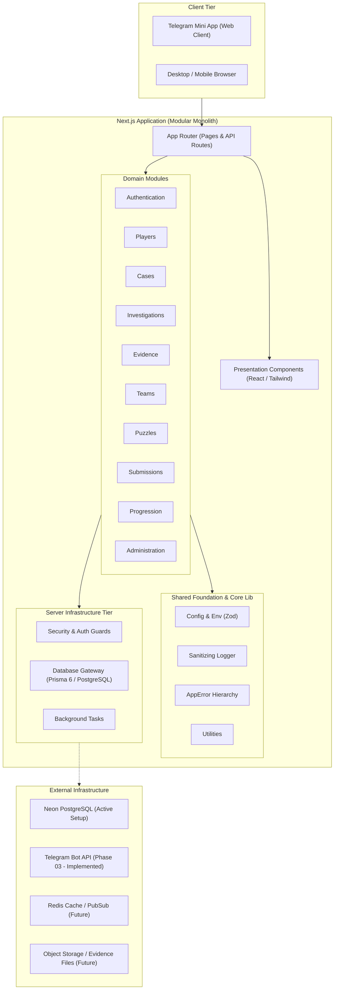

# MYSTERY NETWORK — Architecture

## 1. Architectural Strategy: The Modular Monolith

MYSTERY NETWORK is designed as a **Modular Monolith** built on Next.js (App Router) and TypeScript.

### Rationale

- **Avoid Premature Complexity**: Distributed microservices introduce high operational overhead, distributed transaction failures, network latency, and deployment complexity that drain velocity early in a product's lifecycle.
- **Maintainable Boundaries**: Code is strictly organized into cohesive domain modules with explicit interfaces.
- **Evolutionary Path**: When specific sub-domains experience distinct scaling bottlenecks (e.g., real-time WebSocket investigation boards or heavy background OCR/media processing), the modular boundaries enable extraction into dedicated standalone services with minimal refactoring.

---

## 2. System Architecture Overview

---

## 3. Responsibilities of Major Directories

| Directory                 | Scope & Responsibility                                                                         |
| :------------------------ | :--------------------------------------------------------------------------------------------- |
| `src/app/`                | Next.js App Router root: layouts, page routes, route handlers (`api/`), error boundaries.      |
| `src/components/ui/`      | Primitive, headless, or reusable design system elements (buttons, dialogs, inputs).            |
| `src/components/shared/`  | Shared domain-agnostic composite components (headers, navigational bars, modal wrappers).      |
| `src/components/layouts/` | Structural page layouts (e.g., detective shell, dossier container).                            |
| `src/modules/<domain>/`   | Encapsulated domain logic: types, validation schemas, domain services, queries, and mutations. |
| `src/lib/`                | Cross-cutting shared utilities: configuration parsing, custom errors, logging, sanitization.   |
| `src/server/`             | Server-only infrastructure: database clients, authorization middlewares, security policies.    |
| `src/types/`              | Global ambient types, shared request/response models.                                          |
| `docs/`                   | Architectural specifications, security policies, roadmap, and onboarding documentation.        |
| `tests/`                  | Automated unit, integration, and domain regression test suites.                                |

---

## 4. Module Boundary Rules

1. **Explicit Public Interface**: Modules must expose a clearly defined entry point. Other modules must not reach into private internal implementation files.
2. **No Direct Inter-Module Database Queries**: A module must never query another module's database tables directly. Inter-module communication occurs via defined service interfaces or domain events.
3. **No Database Access in UI Components**: React components (server or client) must never write direct raw queries or bypass domain service boundaries.
4. **Client/Server Separation**: Files containing sensitive logic, database queries, cryptographic keys, or verification hashes must reside strictly on the server (`server-only`).

---

## 5. Architectural Principles

- **Strict Type Safety**: TypeScript strict mode is enabled across the entire workspace. Types are explicit at all system boundaries (API contracts, domain services, schemas).
- **Validation at the Perimeter**: All untrusted external inputs (requests, Telegram payloads, user submissions) are validated using Zod before processing.
- **Fail Fast & Explicitly**: Operational errors use typed `AppError` subclasses with status codes and safe client messaging, preventing silent failures.
- **Sanitized Observability**: Structured JSON logs are generated for all lifecycle events; credentials, private tokens, and confidential player clues are scrubbed automatically.
- **Zero Premature Infrastructure**: No database, ORM, Redis, or WebSockets are introduced before their designated roadmap phase.

---

## 6. Integration Points

- **Neon PostgreSQL & Prisma ORM (Phase 02 - Implemented)**: Centralized connection pooling (`DATABASE_URL`) and direct migration connectivity (`DIRECT_URL`) with singleton client in `src/server/infrastructure/database`. Full details in [DATABASE_ARCHITECTURE.md](./DATABASE_ARCHITECTURE.md).
- **Telegram Bot Webhooks & grammY (Phase 03 - Implemented)**: Official bot integration for `@mysterynetworkbot` handled via secure webhook route handler (`src/app/api/telegram/webhook/route.ts`) with constant-time secret token validation. Full details in [TELEGRAM_BOT.md](./TELEGRAM_BOT.md).
- **Telegram WebApp Authenticator (Phase 04)**: Cryptographic signature verification against the bot token inside `src/modules/authentication`.
