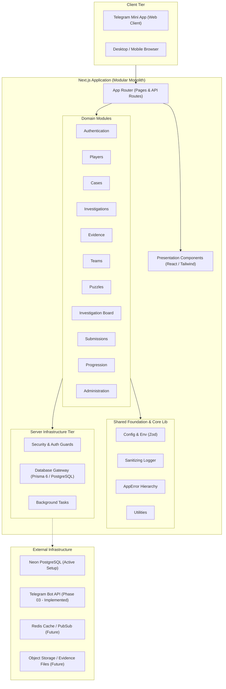

# MYSTERY NETWORK — Architecture

## 1. Architectural Strategy: The Modular Monolith

MYSTERY NETWORK is designed as a **Modular Monolith** built on Next.js (App Router) and TypeScript.

### Rationale

- **Avoid Premature Complexity**: Distributed microservices introduce high operational overhead, distributed transaction failures, network latency, and deployment complexity that drain velocity early in a product's lifecycle.
- **Maintainable Boundaries**: Code is strictly organized into cohesive domain modules with explicit interfaces.
- **Evolutionary Path**: When specific sub-domains experience distinct scaling bottlenecks (e.g., real-time WebSocket investigation boards or heavy background OCR/media processing), the modular boundaries enable extraction into dedicated standalone services with minimal refactoring.

---

## 2. System Architecture Overview

---

## 3. Responsibilities of Major Directories

| Directory                 | Scope & Responsibility                                                                         |
| :------------------------ | :--------------------------------------------------------------------------------------------- |
| `src/app/`                | Next.js App Router root: layouts, page routes, route handlers (`api/`), error boundaries.      |
| `src/components/ui/`      | Primitive, headless, or reusable design system elements (buttons, dialogs, inputs).            |
| `src/components/shared/`  | Shared domain-agnostic composite components (headers, navigational bars, modal wrappers).      |
| `src/components/layouts/` | Structural page layouts (e.g., detective shell, dossier container).                            |
| `src/modules/<domain>/`   | Encapsulated domain logic: types, validation schemas, domain services, queries, and mutations. |
| `src/lib/`                | Cross-cutting shared utilities: configuration parsing, custom errors, logging, sanitization.   |
| `src/server/`             | Server-only infrastructure: database clients, authorization middlewares, security policies.    |
| `src/types/`              | Global ambient types, shared request/response models.                                          |
| `docs/`                   | Architectural specifications, security policies, roadmap, and onboarding documentation.        |
| `tests/`                  | Automated unit, integration, and domain regression test suites.                                |

---

## 4. Module Boundary Rules

1. **Explicit Public Interface**: Modules must expose a clearly defined entry point. Other modules must not reach into private internal implementation files.
2. **No Direct Inter-Module Database Queries**: A module must never query another module's database tables directly. Inter-module communication occurs via defined service interfaces or domain events.
3. **No Database Access in UI Components**: React components (server or client) must never write direct raw queries or bypass domain service boundaries.
4. **Client/Server Separation**: Files containing sensitive logic, database queries, cryptographic keys, or verification hashes must reside strictly on the server (`server-only`).

---

## 5. Architectural Principles

- **Strict Type Safety**: TypeScript strict mode is enabled across the entire workspace. Types are explicit at all system boundaries (API contracts, domain services, schemas).
- **Validation at the Perimeter**: All untrusted external inputs (requests, Telegram payloads, user submissions) are validated using Zod before processing.
- **Fail Fast & Explicitly**: Operational errors use typed `AppError` subclasses with status codes and safe client messaging, preventing silent failures.
- **Sanitized Observability**: Structured JSON logs are generated for all lifecycle events; credentials, private tokens, and confidential player clues are scrubbed automatically.
- **Zero Premature Infrastructure**: No database, ORM, Redis, or WebSockets are introduced before their designated roadmap phase.

---

## 6. Integration Points

- **Neon PostgreSQL & Prisma ORM (Phase 02 - Implemented)**: Centralized connection pooling (`DATABASE_URL`) and direct migration connectivity (`DIRECT_URL`) with singleton client in `src/server/infrastructure/database`. Full details in [DATABASE_ARCHITECTURE.md](./DATABASE_ARCHITECTURE.md).
- **Telegram Bot Webhooks & grammY (Phase 03 - Implemented)**: Official bot integration for `@mysterynetworkbot` handled via secure webhook route handler (`src/app/api/telegram/webhook/route.ts`) with constant-time secret token validation. Full details in [TELEGRAM_BOT.md](./TELEGRAM_BOT.md).
- **Telegram Mini App Authentication (Phase 04 - Implemented)**: HMAC-SHA256 signature verification of `initData`, 300s freshness, clock-skew prevention, transactional player provisioning, and 256-bit server-side session management (`AuthSession`) with hardened HTTP-only cookies in `src/modules/authentication`. Full details in [TELEGRAM_AUTHENTICATION.md](./TELEGRAM_AUTHENTICATION.md).
- **Player Interface & Investigator Dossier (Phase 05 - Implemented)**: Intelligence-styled authenticated application shell, `/dashboard`, `/profile`, operational rank classification (`getRankForLevel`), truthful metrics aggregation, and protected REST API endpoints (`GET /api/player/me`, `PATCH /api/player/profile`) in `src/modules/players`. Full details in [PLAYER_INTERFACE.md](./PLAYER_INTERFACE.md).
- **Case Management & Discovery System (Phase 06 - Implemented)**: Classified case archive (`/cases`), case briefing dossiers (`/cases/[caseId]`), campaign directory (`/campaigns`), campaign detail view (`/campaigns/[slug]`), and sanitized public APIs (`GET /api/cases`, `GET /api/cases/[caseId]`, `GET /api/campaigns`, `GET /api/campaigns/[slug]`). Strict publication status enforcement and absolute redaction of clues, puzzles, and solution hashes. Full details in [CASE_MANAGEMENT.md](./CASE_MANAGEMENT.md).
- **Investigation Engine & Session Management (Phase 07 - Implemented)**: Dynamic operative session execution, concurrency-safe atomic session creation and reuse, state machine lifecycle management (`NOT_STARTED`, `IN_PROGRESS`, `PAUSED`, `SOLVED`, `FAILED`, `ABANDONED`), sequential chapter progression engine, operative workspace at `/investigations/[investigationId]`, personal investigation history at `/investigations`, and secure REST APIs (`POST /api/investigations`, `GET /api/investigations`, `GET /api/investigations/[investigationId]`, `PATCH /api/investigations/[investigationId]/status`, `GET /api/investigations/[investigationId]/progress`, `PATCH /api/investigations/[investigationId]/progress`). Full details in [INVESTIGATION_ENGINE.md](./INVESTIGATION_ENGINE.md).
- **Evidence System & Clue Distribution (Phase 08 - Implemented)**: Persistent evidence vault, asymmetric clue distribution (`ALL_PLAYERS` vs `ASYMMETRIC_EXCLUSIVE`), explicit peer-to-peer evidence sharing between investigation participants, isolated private investigator notes (`EvidenceNote`), secure asset storage abstraction (`StorageService`), anti-IDOR server-side authorization returning uniform 404s, and operative evidence vault UI at `/investigations/[investigationId]/evidence`. Full details in [EVIDENCE_SYSTEM.md](./EVIDENCE_SYSTEM.md).
- **Team Collaboration & Multiplayer Investigation (Phase 09 - Implemented)**: Multi-operative squad formation, hierarchical role guards (`LEAD_INVESTIGATOR`, `DETECTIVE`, `SPECIALIST`), cryptographically secure 256-bit invitation token pipeline with SHA-256 database hashing and sanitized public preview, cooperative squad investigations (`PlayMode.COOPERATIVE`), synchronized participant clue provisioning, asymmetric exclusive clue isolation, and squad operations UI at `/teams`, `/teams/[teamId]`, and `/invitations/[token]`. Full details in [TEAM_COLLABORATION.md](./TEAM_COLLABORATION.md).
- **Interactive Puzzle Engine & Investigation Challenges (Phase 10 - Implemented)**: Pluggable validator registry supporting 7 challenge types (`CAESAR_CIPHER`, `SUBSTITUTION_CIPHER`, `VIGENERE_CIPHER`, `HIDDEN_MESSAGE`, `LOGIC_CHALLENGE`, `ACCESS_CODE`, `MULTI_STAGE`), zero client secret leakage, constant-time HMAC-SHA256 answer validation, advisory transaction locking (`pg_advisory_xact_lock`), individual attempt quotas with rate-limiting lockout (`ATTEMPT_LIMIT_REACHED`), cooperative squad-wide completion (`PuzzleProgress`), progressive hint declassification (`PuzzleHint`), interactive cipher scratchpad, and challenge room at `/investigations/[id]/puzzles`. Full details in [PUZZLE_SYSTEM.md](./PUZZLE_SYSTEM.md).
- **Investigation Board, Evidence Relationships, Timelines & Theories (Phase 11 - Implemented)**: Interactive 2D corkboard workspace (`InvestigationBoardCanvas`), spatial coordinates and viewport persistence, typed node pins (`EVIDENCE`, `SUSPECT`, `LOCATION`, `NOTE`, `CUSTOM`), semantic relational threads (`BoardConnection`) with SVG curved paths and custom styles, chronological forensics log with variable precision (`EXACT`, `APPROXIMATE`, `DATE_ONLY`, `TIME_ONLY`), and hypothesis builder with supporting/contradicting evidence citations. Full details in [INVESTIGATION_BOARD.md](./INVESTIGATION_BOARD.md).
- **Submissions, Evaluation Engine, Results & Player Rewards (Phase 12 - Implemented)**: Structured case accusation and indictment filing (`CaseSubmission`), 6-dimensional deterministic evaluation engine (`EvaluationService`), atomic idempotent XP award ledger (`RewardService`), progression mathematics and badges. Full details in [SUBMISSIONS_AND_REWARDS.md](./SUBMISSIONS_AND_REWARDS.md).
- **Admin Dashboard & Content Management System (Phase 13 - Implemented)**: Granular server-side administrative RBAC (`AdminGuard`), storyline authoring studio for campaigns, cases, chapters, clues, and puzzles (`AdminContentService`), protected solution configuration editor separated via `CASE_MANAGE_SOLUTION`, actionable publication validation engine (`validateCaseForPublication`), privilege escalation guards, last active super admin protection, and tamper-resistant immutable audit ledger (`AdminAuditService`). Full details in [ADMIN_DASHBOARD.md](./ADMIN_DASHBOARD.md).
