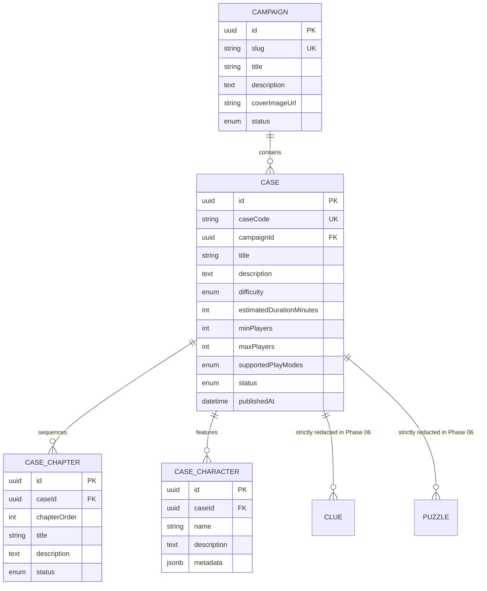

# MYSTERY NETWORK — Phase 06: Case Management & Discovery System

## 1. Overview & Architectural Scope

Phase 06 establishes the Case Management and Discovery subsystem for MYSTERY NETWORK. It bridges the foundational database architecture designed in Phase 02 with the player-facing intelligence interface created in Phase 05, enabling investigators to discover classified cases, browse multi-stage narrative campaigns, and inspect de-classified mission dossiers.

### Core Architectural Mandates

1. **Strict Publication Boundary Enforcement**: Only content with `status: ContentStatus.PUBLISHED` is accessible to operatives. Draft, archived, or unapproved cases/campaigns return HTTP 404 (`CASE_NOT_FOUND` / `CAMPAIGN_NOT_FOUND`) on all public endpoints.
2. **Absolute Content Redaction & OPSEC**: Public case endpoints strictly redact internal investigation artifacts. Clues, asymmetric assignment logic, puzzle answers, cryptographic solution hashes, and scoring rules are never queried or leaked to the client during discovery.
3. **Responsive Intelligence UI**: Built using Next.js App Router server components, Tailwind CSS dark cyber/intelligence styling, and client-side filter controls with reactive URL state and server-side pagination.
4. **Clean Domain Boundary**: Strictly limits scope to discovery and briefing. Dynamic session creation, state machines, and real-time clue telemetry are reserved for Phase 07 (Investigation Engine) and Phase 08 (Evidence System).

---

## 2. Relational Content Modeling (Domain B)

The case discovery system queries Domain B entities from Neon PostgreSQL via Prisma:



---

## 3. Data Transfer Objects (DTO) & Content Redaction

To maintain operational security and avoid leaking game solutions or private notes, all responses pass through explicit DTO mapping functions:

### Safe Case Summary (`SafeCaseSummaryDto`)

- `id`: Case UUID
- `caseCode`: Human-readable identifier (e.g. `CASE-001-MIDNIGHT-PROTOCOL`)
- `title`: Case name
- `description`: De-classified mission synopsis
- `difficulty`: Threat tier (`EASY`, `MEDIUM`, `HARD`, `EXPERT`)
- `estimatedDurationMinutes`: Target operational timeframe
- `minPlayers` / `maxPlayers`: Squad capacity (1 to 4)
- `supportedPlayModes`: `SOLO`, `COOPERATIVE`
- `status`: `PUBLISHED`
- `publishedAt`: Publication ISO timestamp
- `campaign`: Safe reference (`id`, `slug`, `title`) or null
- `chapterCount`: Number of published acts
- `characterCount`: Number of public character dossiers
- `isFeatured`: Boolean priority indicator

### Safe Case Detail (`SafeCaseDetailDto`)

Extends `SafeCaseSummaryDto` with:

- `chapters`: Array of `SafeChapterDto` (`id`, `chapterOrder`, `title`, `description`, `status`, `isLocked`)
- `characters`: Array of `SafeCharacterDto` (`id`, `name`, `description`, `role`, `clearance`, `location`)
- `campaignDetail`: Associated `SafeCampaignSummaryDto` or null

### Redacted Elements

- `clues`: Completely omitted (reserved for Phase 08).
- `puzzles`: Completely omitted (reserved for Phase 10).
- `solutionHash` / `validationLogic`: Strictly excluded.
- `unlockConfig`: Internal progression formulas excluded.
- `character.metadata`: Whitelisted to safe public keys (`role`, `clearance`, `location`). All other fields stripped.

---

## 4. Querying, Filtering, & Server-Side Pagination

The query engine is powered by Zod validation (`CaseQuerySchema`) and Prisma dynamic filtering:

```typescript
export const CaseQuerySchema = z.object({
  search: z.string().trim().max(100).optional(),
  difficulty: z.nativeEnum(CaseDifficulty).optional(),
  campaignSlug: z.string().trim().max(100).optional(),
  sortBy: z.enum(["newest", "oldest", "title", "difficulty"]).default("newest"),
  page: z.coerce.number().int().min(1).default(1),
  limit: z.coerce.number().int().min(1).max(50).default(12),
});
```

### Supported Sort Orders

- `newest`: `orderBy: [{ publishedAt: 'desc' }, { createdAt: 'desc' }]`
- `oldest`: `orderBy: [{ publishedAt: 'asc' }, { createdAt: 'asc' }]`
- `title`: `orderBy: [{ title: 'asc' }]`
- `difficulty`: `orderBy: [{ difficulty: 'asc' }, { publishedAt: 'desc' }]`

### Multi-field Search

Performs case-insensitive `ILIKE` matches across:

- Case Title (`title`)
- Case Codename (`caseCode`)
- Mission Description (`description`)
- Campaign Title (`campaign.title`)

---

## 5. REST API Specification

### 1. `GET /api/cases`

Retrieves a paginated catalog of published cases.

**Query Parameters:**

| Parameter      | Type   | Default     | Description                                              |
| :------------- | :----- | :---------- | :------------------------------------------------------- |
| `search`       | string | `undefined` | Keyword search across title, code, description, campaign |
| `difficulty`   | string | `undefined` | Filter by `EASY`, `MEDIUM`, `HARD`, or `EXPERT`          |
| `campaignSlug` | string | `undefined` | Filter cases by campaign slug                            |
| `sortBy`       | string | `"newest"`  | `"newest"`, `"oldest"`, `"title"`, or `"difficulty"`     |
| `page`         | number | `1`         | Page number (min 1)                                      |
| `limit`        | number | `12`        | Results per page (1 to 50)                               |

**Success Response (HTTP 200):**

```json
{
  "ok": true,
  "data": {
    "items": [
      {
        "id": "c15e3608-a65b-43f0-b6e0-000000000001",
        "caseCode": "CASE-001-MIDNIGHT-PROTOCOL",
        "title": "The Midnight Protocol",
        "description": "An encrypted relay in Zurich was silenced under mysterious circumstances...",
        "difficulty": "MEDIUM",
        "estimatedDurationMinutes": 45,
        "minPlayers": 1,
        "maxPlayers": 4,
        "supportedPlayModes": ["SOLO", "COOPERATIVE"],
        "status": "PUBLISHED",
        "publishedAt": "2026-01-15T00:00:00.000Z",
        "campaign": {
          "id": "b15e3608-a65b-43f0-b6e0-000000000001",
          "slug": "project-midnight",
          "title": "Project Midnight"
        },
        "chapterCount": 2,
        "characterCount": 2,
        "isFeatured": true
      }
    ],
    "total": 1,
    "page": 1,
    "limit": 12,
    "totalPages": 1,
    "hasMore": false
  }
}
```

### 2. `GET /api/cases/[caseId]`

Retrieves classified dossier details by UUID or caseCode.

**Path Parameters:**

- `caseId`: Valid UUID or Case Code (`CASE-001-MIDNIGHT-PROTOCOL`).

**Success Response (HTTP 200):**
Returns `SafeCaseDetailDto` with ordered chapters, public character dossiers, and campaign metadata.

**Error Responses:**

- `400 Bad Request`: `INVALID_CASE_IDENTIFIER`
- `404 Not Found`: `CASE_NOT_FOUND` (if case does not exist or status is not `PUBLISHED`).

### 3. `GET /api/campaigns`

Retrieves all published multi-stage investigation campaigns.

### 4. `GET /api/campaigns/[slug]`

Retrieves campaign briefing details and all associated published cases.

---

## 6. Frontend Interface Architecture

All player views are mounted under the authenticated `AppShell`:

```
src/
├── app/(player)/
│   ├── cases/
│   │   ├── page.tsx               # Case Directory with Hero & Filters
│   │   └── [caseId]/
│   │       └── page.tsx           # Classified Briefing & Person of Interest Dossier
│   └── campaigns/
│       ├── page.tsx               # Campaigns Directory
│       └── [slug]/
│           └── page.tsx           # Campaign Overview & Connected Cases
└── components/
    ├── cases/
    │   ├── case-card.tsx          # Classified dossier card with threat badges
    │   ├── case-search-filters.tsx# Reactive search, difficulty, and sort bar
    │   ├── case-pagination.tsx    # Page navigation controls
    │   └── featured-case-banner.tsx# High-visibility priority investigation hero
    └── campaigns/
        └── campaign-card.tsx      # Multi-case campaign dossier folder
```

---

## 7. Quality Assurance & Verification

- **Automated Tests**: 28 dedicated unit and integration tests in `tests/cases.test.ts`. Total test suite: **129 / 129 passing**.
- **Type Safety**: Zero TypeScript errors (`npm run typecheck`).
- **Linter & Formatting**: 100% compliant with ESLint and Prettier (`npm run lint`, `npm run format:check`).
- **Production Compilation**: Verified Next.js 16.4.5 Turbopack production build (`npm run build`).
