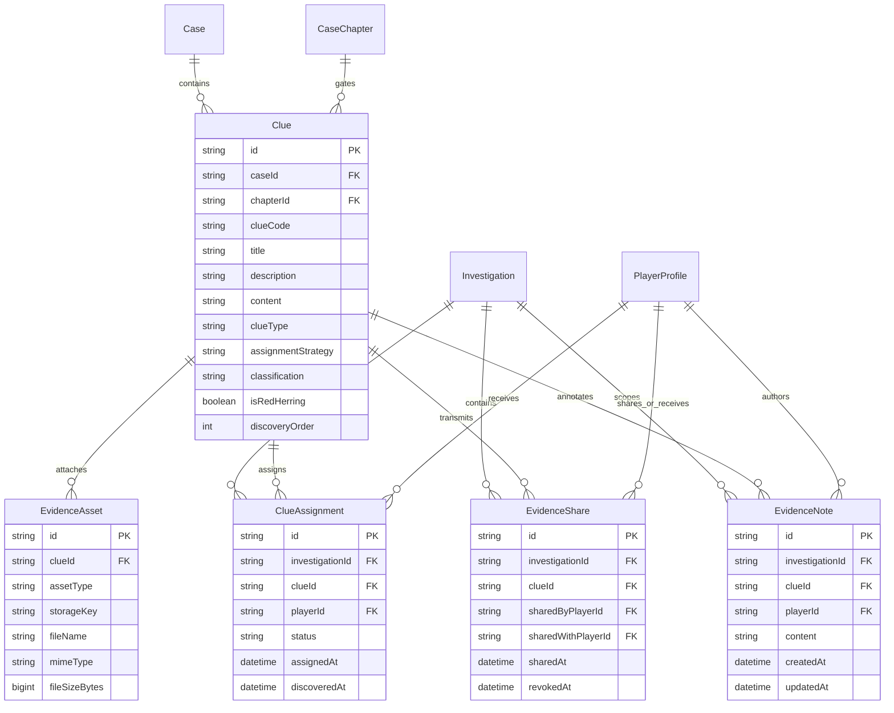
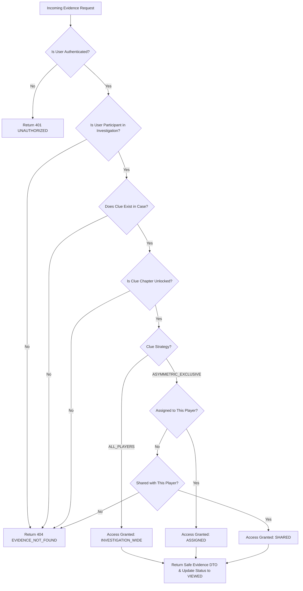

# MYSTERY NETWORK — Phase 08: Evidence System, Clue Distribution & Investigation Analysis

## 1. Overview & Architectural Scope

Phase 08 implements the persistent, security-first Evidence Management, Clue Distribution, and Investigation Analysis subsystem for MYSTERY NETWORK. It bridges the immutable case content definitions established in Phase 02/06 and the persistent session state established in Phase 07 with the interactive investigative tooling where players discover, inspect, analyze, annotate, and explicitly share classified evidence.

### Core Architectural Principles

1. **Strict Separation of Static Definition vs Runtime State**:
   - `Clue` and `EvidenceAsset` records represent immutable mystery templates defined authored into a case.
   - `ClueAssignment`, `EvidenceShare`, and `EvidenceNote` represent active runtime interactions within a specific `Investigation`.
2. **Deterministic Asymmetric Evidence Distribution**:
   - Clues designated with `ALL_PLAYERS` distribution are automatically unlocked for all active investigation participants as chapters are reached.
   - Clues designated with `ASYMMETRIC_EXCLUSIVE` distribution are distributed to a single assigned operative, creating genuine information asymmetry in cooperative investigations.
3. **Explicit Evidence Sharing**:
   - Private evidence remains confidential to the assigned operative until explicitly transmitted via `EvidenceShare`.
   - Evidence can only be shared with verified participants of the same active investigation session. Cross-investigation sharing is blocked server-side.
4. **Anti-IDOR / Anti-Probing Security Model**:
   - Unauthorized access attempts or UUID guessing do not leak existence. The API returns uniform HTTP 404 (`EVIDENCE_NOT_FOUND`) with identical error shapes.
   - Chapter locks are enforced server-side. Clues associated with locked chapters cannot be discovered, assigned, or inspected.
5. **Private Field Notes Isolation**:
   - Investigator notes (`EvidenceNote`) are strictly scoped to the tuple `(investigationId, clueId, playerId)`. Notes are never exposed to teammates, maintaining a personal workspace for deductions.
6. **Robust Storage Abstraction**:
   - Secure storage abstraction (`StorageService`) validates MIME types, enforces a 10 MB file ceiling, sanitizes filenames, generates collision-resistant random keys, and prevents path traversal.

---

## 2. Entity Relationships & Domain Architecture



---

## 3. Evidence Access-Control & Resolution Flow



---

## 4. Static Case Clues vs Runtime Availability

The evidence architecture clearly delineates between immutable design assets and mutable runtime telemetry:

| Concern        | `Clue` / `EvidenceAsset` (Static)                  | `ClueAssignment` / `EvidenceShare` / `EvidenceNote` (Runtime) |
| :------------- | :------------------------------------------------- | :------------------------------------------------------------ |
| **Lifetime**   | Created during case authoring; immutable.          | Created when an investigation is initialized or progresses.   |
| **Scope**      | Global across all runs of the `Case`.              | Strictly bound to a single `Investigation` session.           |
| **Visibility** | Master repository of truth; hidden until unlocked. | Runtime access manifest determining operative permissions.    |
| **Storage**    | Database relational rows + verified storage keys.  | Relational rows referencing operative IDs and timestamps.     |

---

## 5. Asymmetric Clue Distribution Mechanics

To simulate real-world field intelligence, MYSTERY NETWORK avoids dumping identical clues to every investigator:

1. **Chapter Progression Hook**:
   - When an investigation is created via `startInvestigation()`, Act 1 clues are automatically provisioned.
   - When a chapter is completed via `updateChapterProgress()`, newly unlocked clues for the subsequent chapter are automatically provisioned.
2. **Assignment Strategies**:
   - `ALL_PLAYERS`: Every active investigation participant receives a direct assignment record, and the clue is universally accessible.
   - `ASYMMETRIC_EXCLUSIVE`: Distributed in round-robin sequence across active participants. Only the designated operative can access, inspect, and analyze this intelligence initially.
3. **View Status Lifecycle**:
   - `UNSEEN`: Initial state upon provisioning.
   - `VIEWED`: Automatically transitioned when the authorized operative opens the clue detail dossier.

---

## 6. Explicit Evidence Sharing Protocol

Operatives can choose when and with whom to share private intelligence:

1. **Eligibility Check**: An operative can only share a clue if they have direct access to it (`ASSIGNED` or `INVESTIGATION_WIDE`).
2. **Recipient Validation**: The recipient must be an active participant within the **exact same** investigation. Sharing with non-members, players in other investigations, or oneself is strictly blocked.
3. **Idempotent Transmission**: If an active share already exists for `(investigationId, clueId, recipientPlayerId)`, duplicate share records are rejected.
4. **Auditability**: Every share records `sharedByPlayerId`, `sharedWithPlayerId`, and `sharedAt` for forensic squad tracking.

---

## 7. Private Field Notes

Each operative maintains an encrypted notebook for formulating theories:

- **Entity**: `EvidenceNote`
- **Unique Constraint**: `@@unique([investigationId, clueId, playerId])`
- **Privacy Enforcement**: Queries filtering notes always bind `playerId: currentOperative.id`. Other squad members cannot read or query these notes.
- **Maximum Length**: 5,000 characters per clue note, validated via Zod schemas.

---

## 8. Storage Abstraction & Asset Security (`StorageService`)

All file assets (surveillance photos, audio recordings, documents) are managed by `StorageService`:

- **MIME Whitelist**:
  - Images: `image/jpeg`, `image/png`, `image/webp`
  - Audio: `audio/mpeg`, `audio/wav`, `audio/ogg`
  - Documents: `application/pdf`, `text/plain`
- **File Size Ceiling**: Maximum 10 MB (`10,485,760 bytes`), enforced before processing.
- **Key Generation**: Collision-resistant cryptographic keys formatted as `evidence/<clueId>/<randomUUID>.<ext>`.
- **Path Sanitization**: Basename stripping prevents directory traversal (`../`) attacks.
- **URL Streaming**: Generates secure internal `/api/storage/evidence/...` URLs with no exposure of underlying infrastructure credentials.

---

## 9. Benchmark Evidence Manifest (`CASE-001-MIDNIGHT-PROTOCOL`)

Five benchmark clues have been seeded into `CASE-001-MIDNIGHT-PROTOCOL` across Act 1 and Act 2:

| Clue Code    | Title                     | Type     | Chapter | Strategy               | Classification | Description / Role                                                                                            |
| :----------- | :------------------------ | :------- | :------ | :--------------------- | :------------- | :------------------------------------------------------------------------------------------------------------ |
| `EVID-ZR-01` | Server Room Access Log    | DOCUMENT | Act 1   | `ALL_PLAYERS`          | RESTRICTED     | Physical keycard access logs showing unauthorized midnight entry. Includes attached access chart image asset. |
| `EVID-ZR-02` | Tampered Optical Splitter | PHYSICAL | Act 1   | `ASYMMETRIC_EXCLUSIVE` | SECRET         | Physical fiber-optic splitter with secondary tap for packet mirroring. Private to assigned operative.         |
| `EVID-ZR-03` | Intercepted VoIP Audio    | AUDIO    | Act 1   | `ASYMMETRIC_EXCLUSIVE` | TOP_SECRET     | 14-second encrypted VoIP recording of operative discussing exfiltration. Includes attached WAV audio asset.   |
| `EVID-ZR-04` | Encrypted Flash Drive     | DIGITAL  | Act 2   | `ALL_PLAYERS`          | SECRET         | High-grade military USB containing hidden partition. Gated by Act 2 unlock.                                   |
| `EVID-ZR-05` | Corrupted Firmware Image  | DIGITAL  | Act 2   | `ASYMMETRIC_EXCLUSIVE` | TOP_SECRET     | Reverse-engineered router firmware payload. Private to assigned operative upon Act 2 unlock.                  |

---

## 10. REST API Contracts & Endpoint Specification

### 1. `GET /api/investigations/[investigationId]/evidence`

- **Auth**: Cookie-based server session.
- **Query Params**: `scope` (`ALL` | `MINE` | `SHARED` | `INVESTIGATION_WIDE`), `type` (`DOCUMENT` | `PHYSICAL` | etc.), `search` (text search on title/code).
- **Response**:
  ```json
  {
    "success": true,
    "data": {
      "items": [
        {
          "id": "clue-uuid",
          "clueCode": "EVID-ZR-01",
          "title": "Server Room Access Log",
          "description": "...",
          "clueType": "DOCUMENT",
          "classification": "RESTRICTED",
          "accessType": "INVESTIGATION_WIDE",
          "assignmentStatus": "VIEWED",
          "chapterId": "chapter-uuid",
          "isShared": false,
          "hasAssets": true,
          "hasNotes": true,
          "discoveredAt": "2026-11-06T12:00:00.000Z"
        }
      ],
      "total": 1,
      "page": 1,
      "pageSize": 50
    }
  }
  ```

### 2. `GET /api/investigations/[investigationId]/evidence/[evidenceId]`

- **Auth**: Cookie-based server session.
- **Behavior**: Verifies access; auto-transitions `UNSEEN` status to `VIEWED`.
- **Response**: Returns full clue content, parsed assets, private notes for requesting player, and squad sharing manifest.

### 3. `POST /api/investigations/[investigationId]/evidence/[evidenceId]/notes`

- **Body**: `{ "content": "Operative observations..." }`
- **Behavior**: Upserts note strictly scoped to requesting operative.

### 4. `POST /api/investigations/[investigationId]/evidence/[evidenceId]/share`

- **Body**: `{ "recipientPlayerId": "recipient-profile-uuid" }`
- **Behavior**: Validates investigation membership and creates explicit share record.

### 5. `GET /api/investigations/[investigationId]/evidence/shared`

- **Response**: Returns all clues actively shared with the requesting operative.

---

## 11. Security Architecture & Threat Mitigations

| Threat Vector                               | Mitigation Strategy                                                                                   |
| :------------------------------------------ | :---------------------------------------------------------------------------------------------------- |
| **IDOR / UUID Guessing**                    | Non-members and unauthorized investigators receive uniform HTTP 404 (`EVIDENCE_NOT_FOUND`).           |
| **Premature Clue Discovery**                | Clues linked to locked chapters return HTTP 404 and are filtered out of all queries.                  |
| **Information Leakage via Teammate Notes**  | Notes query strictly filters by `playerId: caller.id`. No endpoint exposes notes of other operatives. |
| **Unauthorized Clue Transmission**          | Sharing verifies both sender and recipient belong to the same active investigation session.           |
| **Storage Traversal / Arbitrary Execution** | MIME whitelist, random UUID storage key generation, 10 MB file ceiling, and basename sanitization.    |

---

## 12. Verification & Testing Matrix

The Evidence Subsystem is covered by 20 dedicated automated tests in `tests/evidence.test.ts`:

- **Data Contracts & Validation**: Schema validation, boundary condition tests, invalid enum rejection.
- **Storage Service Security**: File size limits, MIME type filtering, path sanitization, streaming URL generation.
- **Access Control & Anti-IDOR**: Uniform 404 on unassigned exclusive clues, locked chapter suppression, non-participant rejection.
- **Clue Provisioning**: Automatic unlocking on chapter advance, duplicate prevention.
- **Evidence Sharing**: Authorized squad sharing, self-share rejection, non-participant rejection, duplicate share prevention.
- **Private Notes Isolation**: Operative scoping, upsert behavior, note update persistence.
- **API Route Handlers**: Full simulation of GET, POST, and PATCH routes with session authentication.
