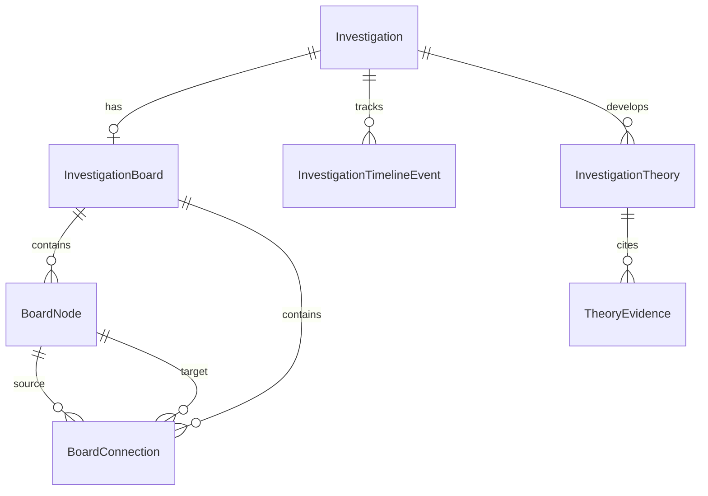

# MYSTERY NETWORK — Investigation Board, Timelines & Theories (Phase 11)

## 1. Overview & Architectural Vision

The **Investigation Board** is the core interactive deductive workspace of MYSTERY NETWORK. It bridges raw evidence collection, chronological forensics, suspect profiling, and deductive hypothesis formulation.

Rather than a static or decorative dashboard, the Investigation Board is a persistent spatial graph pinned to each active investigation session (`InvestigationBoard`). It enables operatives and multiplayer squads to:

1. Pin evidence, suspects, locations, custom notes, and leads directly onto an infinite virtual crime board canvas.
2. Establish directional or reciprocal relationships between entities (e.g. `SUSPECTS`, `CONTRADICTS`, `CORROBORATES`, `ALIBI_FOR`, `COMMUNICATED_WITH`).
3. Construct chronological timelines with both exact timestamps and narrative approximations (`EXACT`, `APPROXIMATE`, `DATE_ONLY`, `TIME_ONLY`).
4. Formulate falsifiable theories & hypotheses, linking supporting and contradicting evidence with explicit forensic rationales.

---

## 2. Database Schema & Data Models

### 2.1 Enums

- **`BoardNodeType`**:
  - `EVIDENCE`: Pinned declassified clue.
  - `SUSPECT`: Person of interest / suspect profile.
  - `LOCATION`: Crime scene or operational site.
  - `NOTE`: Freeform operative observation / sticky memo.
  - `CUSTOM`: Tactical custom entity.
- **`BoardRelationshipType`**:
  - `CONNECTED_TO`: Generic connection.
  - `SUSPECTS`: Direct accusation / suspicion link.
  - `CONTRADICTS`: Incompatibility between two pins.
  - `CORROBORATES`: Mutual verification.
  - `ALIBI_FOR`: Alibi relationship.
  - `COMMUNICATED_WITH`: Telecommunications or in-person contact.
  - `LOCATED_AT`: Geographical or physical presence.
  - `OWNS`: Property or asset possession.
  - `KILLED`: Homicide or termination link.
- **`TimePrecision`**:
  - `EXACT`: Full ISO timestamp precision.
  - `APPROXIMATE`: Estimated chronological anchor.
  - `DATE_ONLY`: Calendar day anchor without hour/minute.
  - `TIME_ONLY`: Specific hour/minute without date constraint.
- **`TheoryStatus`**:
  - `ACTIVE`: Open, actively investigated hypothesis.
  - `PROVEN`: Verified by conclusive evidence chains.
  - `DISPROVEN`: Falsified by contradictory forensic proof.
  - `ABANDONED`: Shelved by squad consensus.
- **`TheoryEvidenceRelationship`**:
  - `SUPPORTS`: Clue substantiates the hypothesis.
  - `CONTRADICTS`: Clue refutes or conflicts with the hypothesis.

### 2.2 Relational Entities

- **`InvestigationBoard`**:
  - `id`: UUID primary key.
  - `investigationId`: Unique foreign key to `Investigation`.
  - `viewport`: JSON object `{ zoom: number, panX: number, panY: number }`.
- **`BoardNode`**:
  - `id`: UUID primary key.
  - `boardId`: Foreign key to `InvestigationBoard`.
  - `nodeType`: `BoardNodeType`.
  - `entityId`: Optional string pointer to domain entities (e.g. `clueId`, `characterId`).
  - `title`: Display name / label.
  - `description`: Optional text.
  - `posX`, `posY`: 2D spatial coordinates on canvas.
  - `pinned`: Boolean pin lock.
  - `color`: Hex color accent (e.g. `#ef4444`).
  - `metadata`: JSON object containing preview data (type, category, thumbnails).
  - `createdByPlayerId`: Foreign key to `PlayerProfile`.
- **`BoardConnection`**:
  - `id`: UUID primary key.
  - `boardId`: Foreign key to `InvestigationBoard`.
  - `sourceNodeId`: Foreign key to `BoardNode`.
  - `targetNodeId`: Foreign key to `BoardNode`.
  - `relationshipType`: `BoardRelationshipType`.
  - `label`: Optional text annotation.
  - `color`: Custom string color.
  - `style`: Line rendering style (`solid`, `dashed`, `dotted`).
  - `createdByPlayerId`: Foreign key to `PlayerProfile`.
  - `@@unique([sourceNodeId, targetNodeId, relationshipType])`: Prevents duplicate connections.
- **`InvestigationTimelineEvent`**:
  - `id`: UUID primary key.
  - `investigationId`: Foreign key to `Investigation`.
  - `title`: Event headline.
  - `description`: Narrative detail.
  - `eventTime`: Optional DateTime.
  - `timePrecision`: `TimePrecision`.
  - `rawTimeLabel`: Human-readable label (e.g. "Approx. 23:45 EST").
  - `orderIndex`: Integer sequence sort fallback.
- **`InvestigationTheory`**:
  - `id`: UUID primary key.
  - `investigationId`: Foreign key to `Investigation`.
  - `title`: Hypothesis title.
  - `description`: Comprehensive rationale.
  - `status`: `TheoryStatus`.
  - `createdByPlayerId`: Foreign key to `PlayerProfile`.
- **`TheoryEvidence`**:
  - `id`: UUID primary key.
  - `theoryId`: Foreign key to `InvestigationTheory`.
  - `clueId`: Foreign key to `Clue`.
  - `relationship`: `TheoryEvidenceRelationship` (`SUPPORTS` | `CONTRADICTS`).
  - `explanation`: Operative rationale for linking this evidence.
  - `@@unique([theoryId, clueId])`: Idempotent clue citation.

---

## 3. Security, Authorization & Integrity (`BoardGuard`)

Every operation across the investigation board, timeline, and hypotheses is gated by `BoardGuard.verifyBoardAccess()`:

1. **Authentication Verification**: Active player profile required.
2. **Investigation Access**: Player must be the creator OR an active enrolled participant (`InvestigationParticipant`).
3. **Disbanded Squad Gate**: If the investigation is associated with a squad (`teamId`), operatives belonging to disbanded teams are rejected (`TEAM_DISBANDED`).
4. **Clue Declassification Check**: When pinning an evidence node or citing evidence in a theory, the clue must exist in the case and be declassified/unlocked for the requesting operative (via `EvidenceService.getEvidenceDetail()`).
5. **Graph Integrity Checks**:
   - Self-connections (`sourceNodeId === targetNodeId`) are rejected with `HTTP 400 INVALID_CONNECTION`.
   - Cross-board connections (linking nodes belonging to different boards) are rejected with `HTTP 400 BOARD_MISMATCH`.
   - Node and connection mutations enforce board ownership validation.

---

## 4. API Endpoints

All endpoints require an authenticated session cookie and active investigation membership:

| Method   | Endpoint                                                                             | Description                                                   |
| :------- | :----------------------------------------------------------------------------------- | :------------------------------------------------------------ |
| `GET`    | `/api/investigations/[investigationId]/board`                                        | Retrieve board, nodes, connections, and viewport coordinates. |
| `PATCH`  | `/api/investigations/[investigationId]/board`                                        | Update viewport `{ zoom, panX, panY }`.                       |
| `POST`   | `/api/investigations/[investigationId]/board/nodes`                                  | Pin a new node (evidence, suspect, note, location).           |
| `PATCH`  | `/api/investigations/[investigationId]/board/nodes/[nodeId]`                         | Move coordinates `(posX, posY)` or edit properties.           |
| `DELETE` | `/api/investigations/[investigationId]/board/nodes/[nodeId]`                         | Remove node (cascades associated connections).                |
| `POST`   | `/api/investigations/[investigationId]/board/connections`                            | Create a relationship thread between two nodes.               |
| `PATCH`  | `/api/investigations/[investigationId]/board/connections/[connectionId]`             | Update connection label, type, or color.                      |
| `DELETE` | `/api/investigations/[investigationId]/board/connections/[connectionId]`             | Delete a relationship thread.                                 |
| `GET`    | `/api/investigations/[investigationId]/timeline`                                     | Get chronological events ordered by timestamp/index.          |
| `POST`   | `/api/investigations/[investigationId]/timeline`                                     | Create a timeline event with precision metadata.              |
| `PATCH`  | `/api/investigations/[investigationId]/timeline/[eventId]`                           | Update a timeline event.                                      |
| `DELETE` | `/api/investigations/[investigationId]/timeline/[eventId]`                           | Delete a timeline event.                                      |
| `GET`    | `/api/investigations/[investigationId]/theories`                                     | List hypotheses with support/contradiction tallies.           |
| `POST`   | `/api/investigations/[investigationId]/theories`                                     | Formulate a new investigative hypothesis.                     |
| `GET`    | `/api/investigations/[investigationId]/theories/[theoryId]`                          | Get theory detail with all linked evidence citations.         |
| `PATCH`  | `/api/investigations/[investigationId]/theories/[theoryId]`                          | Update theory status, title, or description.                  |
| `DELETE` | `/api/investigations/[investigationId]/theories/[theoryId]`                          | Delete theory and cascade associations.                       |
| `POST`   | `/api/investigations/[investigationId]/theories/[theoryId]/evidence`                 | Link evidence with `SUPPORTS` or `CONTRADICTS` relation.      |
| `DELETE` | `/api/investigations/[investigationId]/theories/[theoryId]/evidence/[associationId]` | Unlink an evidence association.                               |

---

## 5. User Interface & Interactive Canvas

### 5.1 Interactive Corkboard (`InvestigationBoardCanvas`)

- Full virtual canvas with pan (drag canvas background) and zoom controls (`+`, `-`, reset).
- Draggable push-pin cards (`BoardCard`) with realistic crime board styling, color tags, and type badges.
- Dynamic SVG strings (`ConnectionLine`) connecting pins with drooping curves, custom colors (red string, amber, blue, green), and interactive relationship labels.
- Modal dialog (`ConnectionDialog`) to easily select relationship semantics between two chosen pins.

### 5.2 Slide-Over Drawers

- **Evidence Drawer (`EvidenceDrawer`)**: Inspect declassified case clues and click "Pin to Board" with instant placement.
- **Suspects & Characters Drawer (`CharactersDrawer`)**: Inspect case persons of interest and pin suspect profiles with their role and avatar.
- **Timeline Panel (`TimelineDrawer`)**: Chronological forensic log displaying exact or approximate event timestamps with add/delete controls.
- **Theories & Hypotheses Panel (`TheoriesDrawer`)**: Full hypothesis workbench to formulate deductive angles, monitor corroboration balances (`+N Supports`, `-M Contradicts`), and link/unlink clues.

### 5.3 Quick Navigation

- `/board`: Direct route redirecting to the operative's most recent active case board or displaying an investigation selector.
- `WorkspaceHeader`: Persistent "Crime Board" navigation pill on all investigation views.
- Investigation Workspace: Direct Crime Board launcher card.
