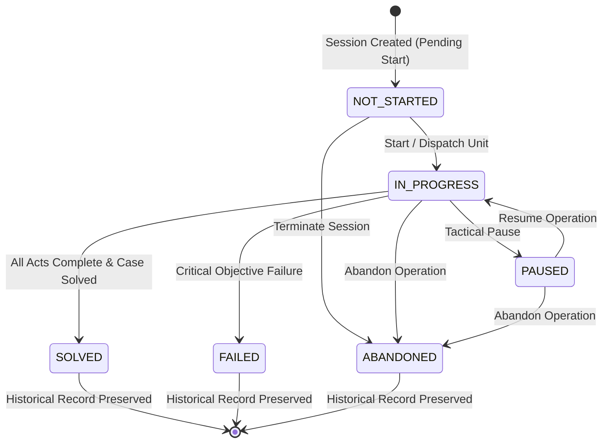

# MYSTERY NETWORK — Phase 07: Investigation Engine & Session Management

## 1. Overview & Architectural Scope

Phase 07 implements the persistent Investigation Engine and Session Management subsystem for MYSTERY NETWORK. It bridges the immutable case content definitions established in Phase 02/06 with the real-time execution environment where players investigate crimes, track chapter progression, pause and resume field sessions, and preserve complete historical records.

### Core Architectural Principles

1. **Separation of Content and Execution**:
   - A `Case` (e.g. `CASE-001-MIDNIGHT-PROTOCOL`) is an immutable, reusable mystery template.
   - An `Investigation` represents an actual execution session of that case by one or more authenticated operatives.
2. **Strict Participant Authorization & Privacy**:
   - Investigation sessions, chapter states, and operational telemetry are strictly private to authorized participants.
   - Guessing an investigation UUID returns HTTP 404 (`INVESTIGATION_NOT_FOUND`) to prevent existence probing.
3. **Deterministic State Machine & Lifecycle**:
   - All state transitions (`NOT_STARTED`, `IN_PROGRESS`, `PAUSED`, `SOLVED`, `FAILED`, `ABANDONED`) are enforced server-side. Client requests cannot bypass state validation.
4. **Concurrency Safety & Atomic Session Reuse**:
   - Interactive database transactions and active session inspection prevent duplicate sessions when players double-click or issue concurrent requests.
5. **Persistent Chapter Progression**:
   - Progress is persisted sequentially in Neon PostgreSQL (`InvestigationProgress`). Completing an act atomically unlocks the next act.

---

## 2. Investigation Lifecycle & State Machine

The investigation lifecycle governs operative sessions from dispatch through final case resolution:



### Transition Validation Rules

| Current Status | Allowed Action | Resulting Status | Business Requirement                                                                       |
| :------------- | :------------- | :--------------- | :----------------------------------------------------------------------------------------- |
| `NOT_STARTED`  | `RESUME`       | `IN_PROGRESS`    | Operative enters the field. Sets `startedAt = now()`.                                      |
| `NOT_STARTED`  | `ABANDON`      | `ABANDONED`      | Session cancelled prior to entering the field.                                             |
| `IN_PROGRESS`  | `PAUSE`        | `PAUSED`         | Operative steps away. Freezes timer and disables progression updates.                      |
| `IN_PROGRESS`  | `ABANDON`      | `ABANDONED`      | Operative forfeits the investigation. Terminal state.                                      |
| `IN_PROGRESS`  | `COMPLETE`     | `SOLVED`         | Valid only when **all tactical acts** have status `COMPLETED`. Sets `completedAt = now()`. |
| `PAUSED`       | `RESUME`       | `IN_PROGRESS`    | Operative re-enters active investigation.                                                  |
| `PAUSED`       | `ABANDON`      | `ABANDONED`      | Operative forfeits while in pause.                                                         |
| `SOLVED`       | _None_         | _Immutable_      | Concluded cases cannot be re-opened; historical integrity is preserved.                    |
| `FAILED`       | _None_         | _Immutable_      | Failed operations cannot be silently resumed.                                              |
| `ABANDONED`    | _None_         | _Immutable_      | Abandoned records remain preserved in history.                                             |

---

## 3. Session Reuse Policy & Concurrency Safety

### Duplicate Prevention Policy

When an operative requests `POST /api/investigations` with a `caseIdentifier`:

1. The case definition is resolved and validated as `ContentStatus.PUBLISHED`.
2. The authenticated player's `PlayerProfile` is resolved.
3. Within an interactive database transaction:
   - Queries `InvestigationParticipant` for active membership in any investigation on the target case with status in `[IN_PROGRESS, PAUSED, NOT_STARTED]`.
   - **If an active session exists**: Reuses and returns the existing `investigationId` (`wasResumed: true`). If it was `PAUSED`, it automatically transitions to `IN_PROGRESS`.
   - **If no active session exists**: Creates a new `Investigation`, adds the player as `InvestigationParticipant` (`status: ACTIVE`), initializes sequential `InvestigationProgress` records, and returns `wasResumed: false`.
4. Concurrency guarantee: Interactive transactions and participant uniqueness prevent race-condition duplicates.

---

## 4. Sequential Chapter Progression Engine

Chapter progression is persisted per `(investigationId, chapterId)` in the `investigation_progress` table:

```
Case: CASE-001-MIDNIGHT-PROTOCOL
├── Chapter 1 (Order 1): IN_PROGRESS (unlockedAt: now())
└── Chapter 2 (Order 2): LOCKED      (unlockedAt: null)
```

1. **Starting a Chapter (`START_CHAPTER`)**:
   - Allowed only if the chapter status is `UNLOCKED`.
   - Transitions chapter status to `IN_PROGRESS`.
   - Attempts to start a `LOCKED` chapter return HTTP 400 (`CHAPTER_LOCKED`).
2. **Completing a Chapter (`COMPLETE_CHAPTER`)**:
   - Allowed only if the chapter status is `IN_PROGRESS` or `UNLOCKED`.
   - Sets chapter status to `COMPLETED` and `completedAt = now()`.
   - Finds the subsequent chapter in numerical sequence (`chapterOrder + 1`).
   - If a subsequent chapter exists and is `LOCKED`, automatically updates it to `UNLOCKED` and sets `unlockedAt = now()`.
3. **Session State Gate**:
   - Progression actions require the parent investigation to be in `IN_PROGRESS` status. Requests on `PAUSED` or terminal investigations return HTTP 400 (`INVESTIGATION_NOT_ACTIVE`).

---

## 5. REST API Specifications

### 1. `POST /api/investigations`

Dispatches a new investigation or resumes an active one.

**Request Body:**

```json
{
  "caseIdentifier": "CASE-001-MIDNIGHT-PROTOCOL"
}
```

**Response (HTTP 201 Created or 200 OK):**

```json
{
  "ok": true,
  "data": {
    "investigationId": "00000000-0000-4000-a000-000000000008",
    "wasResumed": false
  }
}
```

### 2. `GET /api/investigations`

Retrieves paginated personal investigation history.

**Query Parameters:**

- `status`: Optional filter (`IN_PROGRESS`, `PAUSED`, `SOLVED`, `ABANDONED`).
- `page`: Page number (default: 1).
- `limit`: Page size (default: 10, max: 50).

### 3. `GET /api/investigations/[investigationId]`

Retrieves complete operative workspace DTO. Enforces participant authorization.

### 4. `PATCH /api/investigations/[investigationId]/status`

Executes an allowed lifecycle action (`PAUSE`, `RESUME`, `ABANDON`, `COMPLETE`).

**Request Body:**

```json
{
  "action": "PAUSE"
}
```

### 5. `GET /api/investigations/[investigationId]/progress`

Retrieves sequential chapter progression list.

### 6. `PATCH /api/investigations/[investigationId]/progress`

Advances chapter progression.

**Request Body:**

```json
{
  "chapterId": "00000000-0000-4000-a000-000000000006",
  "action": "COMPLETE_CHAPTER"
}
```

---

## 6. Frontend Interface & Operative Workspace

1. **Case Briefing Integration (`/cases/[caseId]`)**:
   - Deploys `StartInvestigationButton` with loading indicator and error handling.
   - Dispatches or resumes the investigation, routing the operative directly into the workspace.
2. **Investigation Workspace (`/investigations/[investigationId]`)**:
   - `WorkspaceHeader`: Displays case code, active threat level, live session status badge, started timestamp, and action buttons (Pause, Resume, Finalize Case, Abandon).
   - `ChapterProgressionBoard`: Interactive act-by-act roadmap. Displays `LOCKED`, `UNLOCKED`, `IN_PROGRESS`, and `COMPLETED` acts with `ENTER THIS ACT` and `CONCLUDE ACT` operative buttons.
   - Persons of Interest Dossier: Displays de-classified character dossiers.
   - Modular Peripherals Placeholder: Visually reserves slots for Evidence Vault (Phase 08), Squad Sync (Phase 09), Cipher Terminal (Phase 10), and Crime Board (Phase 11).
3. **Investigation History Directory (`/investigations`)**:
   - Status tabs (`All`, `Active`, `Paused`, `Solved`).
   - Cards displaying case metadata, completed act progress bar, timestamps, and workspace resume links.

---

## 7. Quality Assurance & Verification

- **Automated Tests**: 24 dedicated unit and integration tests in `tests/investigations.test.ts`. Total test suite: **153 / 153 passing** across 8 test suites.
- **Type Safety**: 0 errors (`npm run typecheck`).
- **Linter & Formatting**: 100% compliant (`npm run lint`, `npm run format:check`).
- **Production Build**: Verified Next.js 16.4.5 Turbopack production compilation (`npm run build`).
