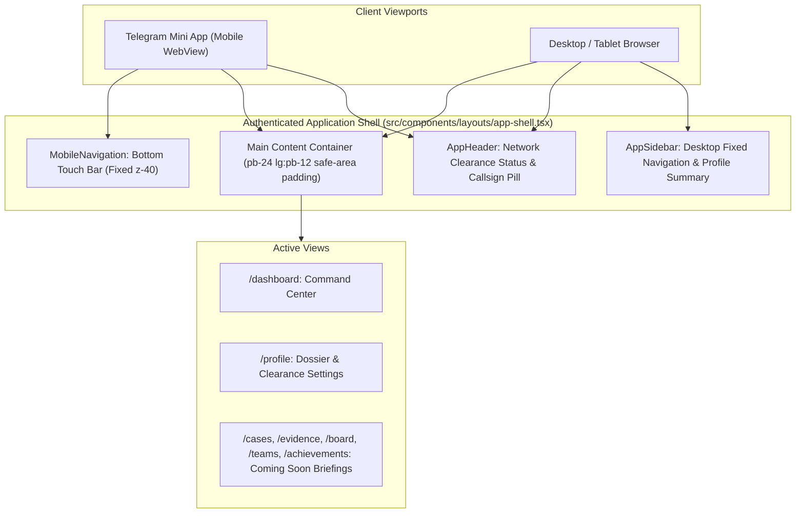

# MYSTERY NETWORK — Player Interface & Investigator Dossier

## 1. Overview & Experience Direction

**MYSTERY NETWORK** delivers an immersive, intelligence-agency-style operative interface designed for collaborative detectives across both Telegram Mini App and desktop browser environments.

Rather than adopting a generic gaming or SaaS dashboard aesthetic, the interface is styled as a classified **Central Intelligence Console**:

- **Palette**: Deep navy (`#090c12`, `#0f1523`, `#131b2e`) and near-black surfaces with thin structural borders (`#1a233a`).
- **Accents**: Restrained cyan (`#38bdf8`, `#22d3ee`) for verified clearance markers and warm amber (`#f59e0b`) for classified notices and commendations.
- **Typography**: Clean sans-serif hierarchy for dossier data paired with crisp monospace markers for callsigns, system statuses, and security clearance designations.
- **Data Integrity**: Real database metrics only. Zero fabricated activity timelines, zero fake charts, and zero simulated leveling formulas.

---

## 2. Authenticated Application Shell

The application shell provides unified navigation, layout consistency, and responsive adaptability across devices.



### Desktop Layout

- **Fixed Sidebar Navigation (`AppSidebar`)**: 256px wide persistent rail with brand shield, categorized navigation links, active route highlight, operative badge, and sign-out button.
- **Top Bar (`AppHeader`)**: Displays live clearance protocol status, encrypted session statement, and quick link to `/profile`.

### Mobile & Telegram Mini App Layout

- **Bottom Navigation (`MobileNavigation`)**: Touch-friendly 4-tab bar fixed to the bottom with safe-area inset handling (`pb-[max(0.5rem,env(safe-area-inset-bottom))]`).
- **Top Header**: Compact title and clearance badge.
- **No Horizontal Overflow**: All dossier cards and tables adapt fluidly with zero horizontal scrollbars on mobile viewports down to 320px width.

---

## 3. Main Dashboard Architecture (`/dashboard`)

The dashboard serves as the detective's operational briefing desk.

### A. Welcome & Identity Header (`WelcomeHeader`)

- Verified operative clearance badge (`STATUS: ACTIVE`).
- Callsign and public investigator name.
- Operational classification title and clearance tier (e.g. `Junior Operative (LEVEL 1 — CONFIDENTIAL)`).
- Profile avatar or generated 2-character initials badge.
- Enrollment date.

### B. Investigator Dossier Card (`InvestigatorDossierCard`)

- Central registry reference (`REF: <UUID_PREFIX>`).
- Callsign, Rank title, Specialization (e.g. _Forensic Analysis_, _Field Intelligence_), and total accrued XP.
- Quick link to manage clearance settings.

### C. Progression & Operational Standing Panel (`ProgressionPanel`)

- Current operational Level.
- Accumulated XP total.
- Commendations count derived from real `UserAchievement` database records.
- Honest progression notice: Explains that XP and advancement are granted upon verified case milestones and puzzle decryptions, without inventing fake leveling bars.

### D. Investigation Operations Overview (`InvestigationOverview`)

- Real metrics queried from Neon PostgreSQL:
  - Active cases: `prisma.investigationParticipant.count({ status: ACTIVE, investigation: { status: IN_PROGRESS } })`
  - Solved cases: `prisma.investigationParticipant.count({ investigation: { status: SOLVED } })`
  - Assigned clues: `prisma.clueAssignment.count({ playerId })`
- **Honest Empty State**: If no active investigations exist, renders a classified standby notice: _"Your investigation record is waiting. No active investigations yet. New cases will appear here when the investigation network opens its next operations."_

### E. Commendations Panel (`AchievementsPanel`)

- Displays actual unlocked achievements from `UserAchievement`.
- If unearned, displays a designed empty state explaining that commendations are unlocked through forensic clue discovery, puzzle solving, and theory filing.

### F. Authentication & Operative Log (`RecentActivityPanel`)

- Derives truthful activity from real timestamps (enrollment date, last verified authentication timestamp). Zero fabricated gameplay history.

---

## 4. Profile & Dossier Management (`/profile`)

The `/profile` route enables investigators to customize permitted public identity fields while strictly locking progression and authorization data.

### Editable Fields

| Field                   | Validation Rule                                                                                        | Target Storage                             |
| :---------------------- | :----------------------------------------------------------------------------------------------------- | :----------------------------------------- |
| **Callsign / Codename** | 3-30 characters, alphanumeric + `_`, uppercased                                                        | `PlayerProfile.codename` (Unique)          |
| **Display Name**        | 1-50 characters, trimmed                                                                               | `PlayerProfile.displayName`                |
| **Specialization**      | Enum (`Field Intelligence`, `Forensic Analysis`, `Cipher & Cryptography`, `Interrogation & Profiling`) | `PlayerProfile.preferences.specialization` |
| **Theme**               | Enum (`navy`, `noir`)                                                                                  | `PlayerProfile.preferences.theme`          |
| **Language Code**       | 2-10 characters                                                                                        | `User.languageCode`                        |

### Security Invariance & Protection Rules

- **Server Authorization**: Authentication is verified via `requireAuthenticatedUser()`. Client-supplied user IDs are completely ignored.
- **Unique Codename Check**: If an operative requests a codename change, the backend verifies uniqueness against all other profiles in the database. If already claimed, returns HTTP 409 (`CODENAME_TAKEN`).
- **Protected Fields**: Any attempt to send `xp`, `level`, `rank`, `role`, or `status` is strictly rejected by the Zod schema (`.strict()`).
- **Progress Preservation**: Updating codename or display name preserves existing investigations, clue assignments, puzzle attempts, and team memberships without data loss.

---

## 5. Navigation Architecture & Future Modules

To ensure a seamless user experience, navigation items for future phases are clearly labeled and routed to classified intelligence briefings rather than dead ends or fake mockups:

| Route           | Module Name                       | Status                        | Scheduled Target                |
| :-------------- | :-------------------------------- | :---------------------------- | :------------------------------ |
| `/dashboard`    | Command Dashboard                 | **Active & Fully Functional** | Phase 05                        |
| `/profile`      | Investigator Dossier              | **Active & Fully Functional** | Phase 05                        |
| `/cases`        | Case Operations & Catalog         | Standby Clearance Briefing    | Phase 06: Case Management       |
| `/evidence`     | Evidence Locker & Forensic Clues  | Standby Clearance Briefing    | Phase 08: Evidence System       |
| `/board`        | Collaborative Investigation Board | Standby Clearance Briefing    | Phase 11: Investigation Board   |
| `/teams`        | Squads & Operative Units          | Standby Clearance Briefing    | Phase 09: Team Collaboration    |
| `/achievements` | Commendation Registry             | Standby Clearance Briefing    | Phase 12: Submissions & Rewards |

---

## 6. API Reference

### 1. `GET /api/player/me`

Retrieves the authenticated player's complete dossier, operational stats, and unlocked achievements.

- **Authentication**: Required (`mn_session` cookie).
- **Success Response (HTTP 200)**:
  ```json
  {
    "ok": true,
    "data": {
      "dossier": {
        "id": "e2a4b8c9-1111-2222-3333-444455556666",
        "userId": "c15e3608-a65b-43f0-b6e8-000000000001",
        "codename": "AGENT_SHERLOCK",
        "displayName": "Sherlock Holmes",
        "avatarUrl": null,
        "xp": 450,
        "level": 3,
        "rank": {
          "minLevel": 3,
          "title": "Field Investigator",
          "badge": "INV-2",
          "description": "Active operative clearance.",
          "clearanceLevel": "LEVEL 2 — RESTRICTED"
        },
        "specialization": "Forensic Analysis",
        "preferences": { "theme": "navy" },
        "joinedAt": "2026-11-05T20:30:00.000Z",
        "lastActiveAt": "2026-11-06T09:40:00.000Z",
        "status": "ACTIVE",
        "telegramUsername": "sherlock"
      },
      "stats": {
        "activeInvestigations": 0,
        "completedInvestigations": 0,
        "totalCluesCollected": 0,
        "unlockedAchievementsCount": 0
      },
      "achievements": [],
      "recentActivity": [...]
    }
  }
  ```

### 2. `PATCH /api/player/profile`

Updates permitted identity attributes for the authenticated player.

- **Authentication**: Required (`mn_session` cookie).
- **Request Body**:
  ```json
  {
    "codename": "AGENT_HOLMES",
    "displayName": "Consulting Detective Sherlock Holmes",
    "specialization": "Forensic Analysis",
    "theme": "noir",
    "languageCode": "en"
  }
  ```
- **Success Response (HTTP 200)**:
  ```json
  {
    "ok": true,
    "message": "Investigator dossier updated successfully",
    "dossier": { ...PlayerDossier }
  }
  ```
- **Error Responses**:
  - `400 Bad Request`: Validation failure or attempt to submit protected fields (`VALIDATION_ERROR`, `MALFORMED_JSON`).
  - `401 Unauthorized`: Session cookie missing or expired (`UNAUTHORIZED`).
  - `409 Conflict`: Codename is already claimed by another operative (`CODENAME_TAKEN`).

---

## 7. Automated Test Suite

Automated tests for Phase 05 are located in [`tests/player.test.ts`](../tests/player.test.ts):

```bash
# Run player interface tests specifically
npx vitest run tests/player.test.ts

# Run all application test suites (Foundation, Health, Telegram, Auth, Player, Database)
npm run test
```

### Coverage Scope

1. **Rank Derivation**: All 5 clearance tiers (`OP-1` to `MST-5`), boundary checks, and non-positive level handling.
2. **Zod Validation Schema**: Valid updates, invalid codename characters/length, and strict rejection of protected fields (`xp`, `level`).
3. **Player Service**: Dossier retrieval, full dashboard statistics aggregation, honest empty state reporting, and codename collision detection.
4. **API Route Handlers**: Unauthenticated request rejection, validation failure handling, 409 collision rejection, and successful profile updates.
