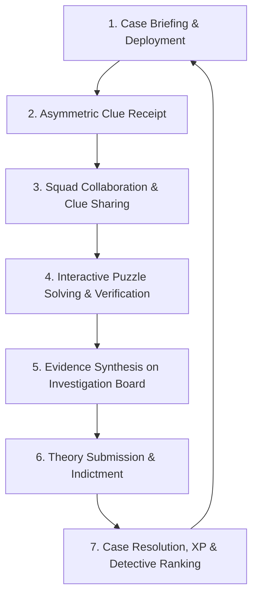

# MYSTERY NETWORK — Product Overview

## 1. Executive Summary

**MYSTERY NETWORK** is a global collaborative detective investigation platform delivered initially through a Telegram Mini App and web ecosystem.

The platform immerses players in interconnected mystery cases, episodic crime fiction, corporate espionage, and supernatural investigations. Built on the core principle:

> **"Every player knows something. Nobody knows everything."**

Players do not receive identical information; instead, clues, witness testimonies, and physical evidence fragments are distributed asymmetrically across participants and squads. Solving a case requires collective deduction, cross-referencing findings, decoding interactive puzzles, and building collaborative investigation boards.

---

## 2. Target Audience

1. **Puzzle & Mystery Enthusiasts**: Fans of escape rooms, ARGs (Alternate Reality Games), detective fiction, true-crime podcasts, and logic deduction challenges.
2. **Cooperative Gaming Communities**: Squads, Discord/Telegram groups, and friends seeking intellectually engaging multiplayer experiences that do not require high-end hardware.
3. **Telegram Global User Base**: Millions of international users seeking rich, native Mini App experiences with instant access, social sharing, and low barrier to entry.

---

## 3. Main Product Capabilities

- **Telegram Bot & Mini App Integration**: Instant frictionless onboarding, contextual alerts, clue dispatching, and rich web interface directly within Telegram.
- **Asymmetric Evidence Distribution**: Different players receive different clues, witness statements, and forensic documents, mandating collaboration.
- **Squad & Team Collaboration**: Dedicated investigation rooms, secure clue sharing, and shared squad hypothesis boards.
- **Interactive Puzzles & Forensics**: Cryptograms, cipher wheels, audio waveform inspection, timeline reconstruction, and geospatial maps.
- **Dynamic Investigation Board**: Node-based pinning of suspects, motives, evidence items, and connections.
- **Theory Submissions & Scoring**: Formal case hypothesis filing, evidence attachment, accuracy scoring, and leaderboard ranking.
- **Investigator Dossier & Progression**: Persistent XP, ranks (e.g., Rookie, Detective, Lead Inspector, Master Sleuth), specialty badges, and achievement showcase.
- **Operational Admin Suite**: Tooling for mystery authors and platform administrators to curate, monitor, and balance cases.

---

## 4. Core Gameplay Loop

1. **Briefing & Deployment**: The squad receives a case file with high-level incidents, suspect lists, and initial briefings.
2. **Asymmetric Clue Receipt**: Individual investigators receive distinct clues based on assigned roles, actions, or random distribution.
3. **Squad Collaboration**: Players compare leads, discuss discrepancies, and discover hidden correlations.
4. **Interactive Forensics**: Deciphering encryptions, analyzing audio recordings, or unlocking password-protected terminals.
5. **Investigation Board Synthesis**: Connecting suspects, alibis, murder weapons, and timeline anomalies.
6. **Theory Submission**: Submitting the final indictment citing required supporting evidence.
7. **Resolution & Scoring**: Automated evaluation against canonical solutions, awarding XP, badges, and unlocking the next episodic chapter.

---

## 5. Long-Term Product Direction

- **Creator & Community Studio**: Enabling verified mystery authors to design, script, and publish community investigations with monetization and tipping mechanics.
- **Live Episodic Events**: Global synchronized investigative events where thousands of players uncover a breaking world mystery in real-time.
- **Multi-Platform Expansion**: Seamless cross-play between Telegram Mini App, mobile web, desktop, and native mobile clients.
- **AI Witness Interviews (Future)**: Autonomous fictional persona witnesses bounded by canonical case truth tables and interrogation guardrails.
