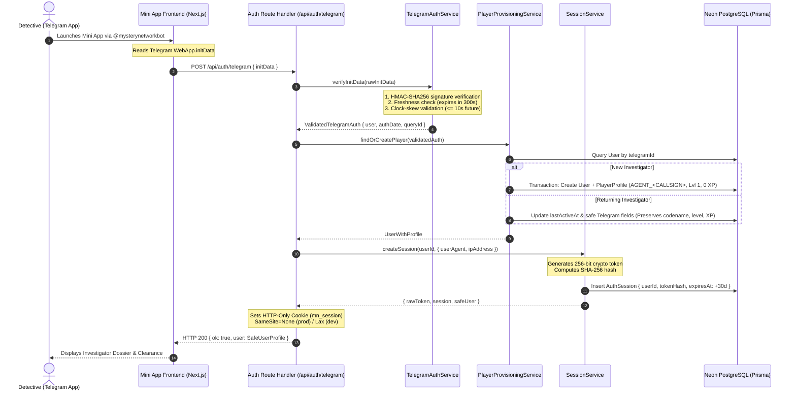

# MYSTERY NETWORK — Telegram Mini App Authentication

## 1. Overview & Architecture

**MYSTERY NETWORK** employs a zero-trust, cryptographically verified authentication architecture tailored for Telegram Mini Apps. Player identity is derived directly from Telegram's WebApp launch payload (`Telegram.WebApp.initData`), verified server-side using HMAC-SHA256 with the bot secret token, and persisted via server-side session records (`AuthSession`) backed by hardened HTTP-only cookies.

### Authentication Sequence



---

## 2. Cryptographic Verification Specification

Every Mini App launch provides an encrypted/signed query string in `window.Telegram.WebApp.initData`. Client-supplied user objects or IDs are **never** trusted without verifying this cryptographic signature.

### Verification Algorithm

1. **HMAC-SHA256 Derivation**:
   - Telegram signs the data by computing a secret key: `HMAC_SHA256("WebAppData", bot_token)`.
   - The data-check-string is formed by sorting all key-value pairs (except `hash` and `signature`) alphabetically, joined by newline characters (`\n`).
   - The hex digest of `HMAC_SHA256(data_check_string, secret_key)` must strictly match the incoming `hash`.
   - We utilize `@tma.js/init-data-node` (v2.0.8) for rigorous cryptographic enforcement.

2. **Freshness & Expiration Policy**:
   - `INIT_DATA_MAX_AGE_SECONDS = 300` (5 minutes).
   - Any launch token older than 300 seconds is rejected with HTTP 401 (`EXPIRED_INIT_DATA`).
   - Replay attacks or stale launch URLs cannot be reused.

3. **Clock Skew Tolerance**:
   - `MAX_CLOCK_SKEW_SECONDS = 10` (10 seconds).
   - Any payload where `auth_date` is more than 10 seconds into the future (indicating a manipulated client clock or timestamp injection) is rejected with HTTP 401 (`FUTURE_AUTH_DATE`).

4. **Payload Sanitization & Boundary Validation**:
   - `id`: Checked with `Number.isSafeInteger(id) > 0`.
   - `first_name`: Required non-empty string, trimmed.
   - `username`, `last_name`, `language_code`: Trimmed and validated.
   - Max payload length: 8,192 characters.

---

## 3. Identity Provisioning & Returning Player Rules

### 64-bit Integer Precision Safety

Telegram user IDs are 64-bit integers (`BigInt` in PostgreSQL / Prisma). Because standard JavaScript JSON serialization truncates numbers above `2^53 - 1` (`Number.MAX_SAFE_INTEGER`), the system implements `SafeUserProfile`, which guarantees `telegramId` is converted to a string before JSON serialization.

### Account Creation & Codename Generation

When an investigator authenticates for the first time:

- A new `User` record is created with status `ACTIVE`.
- An associated `PlayerProfile` is created in an isolated database transaction:
  - **Codename**: Generated as `AGENT_<TELEGRAM_USERNAME>` (e.g. `AGENT_SHERLOCK`). If the player has no username, it falls back to `AGENT_OPERATIVE_<ID_SUFFIX>`.
  - **Collision Handling**: If the generated codename is already claimed by another operative, a random 2-byte hexadecimal suffix is appended (e.g. `AGENT_SHERLOCK_B4F2`).
  - **Initial Progression**: Level `1`, XP `0`, preferences `{}`.

### Returning Player Guarantee

When a returning player connects:

- Their existing account is resolved by `telegramId`.
- Safe identity attributes (`firstName`, `lastName`, `telegramUsername`, `languageCode`, `lastActiveAt`) are synchronized.
- **Strict Invariance**: Custom codenames, earned levels, XP, puzzle progress, inventory, and investigations are **never overwritten or reset**.

---

## 4. Server-Side Session Management

### Session Architecture (`AuthSession` Model)

| Field            | Type           | Description                                                |
| :--------------- | :------------- | :--------------------------------------------------------- |
| `id`             | `UUID`         | Primary session identifier.                                |
| `userId`         | `UUID`         | Foreign key referencing `User.id` (Cascades on delete).    |
| `tokenHash`      | `VARCHAR(64)`  | Unique SHA-256 digest of the 256-bit session token.        |
| `userAgent`      | `VARCHAR(500)` | Client User-Agent metadata for security auditing.          |
| `ipAddress`      | `VARCHAR(100)` | Client IP address from `x-forwarded-for`.                  |
| `createdAt`      | `TIMESTAMP`    | Session issuance timestamp.                                |
| `expiresAt`      | `TIMESTAMP`    | Expiration timestamp (Default: +30 days).                  |
| `lastActivityAt` | `TIMESTAMP`    | Updated periodically on active session validation.         |
| `revokedAt`      | `TIMESTAMP`    | Populated upon manual logout or administrative revocation. |

### Token Security

- **Entropy**: 256 bits generated via `crypto.randomBytes(32).toString('hex')`.
- **Zero Raw Secret Storage**: The database stores **only** the SHA-256 hash. Even a full database dump cannot be used to forge session tokens.
- **Timing-Safe Comparison**: Constant-time comparison (`crypto.timingSafeEqual`) prevents timing attack vulnerabilities during token validation.

### Cookie Configuration

| Option     | Value (Development)  | Value (Production)   | Rationale                                                                                                                  |
| :--------- | :------------------- | :------------------- | :------------------------------------------------------------------------------------------------------------------------- |
| `name`     | `mn_session`         | `mn_session`         | Standardized session cookie key.                                                                                           |
| `httpOnly` | `true`               | `true`               | Prevents XSS script access to session tokens.                                                                              |
| `secure`   | `false`              | `true`               | Mandates HTTPS transmission in production.                                                                                 |
| `sameSite` | `lax`                | `none`               | **Critical**: Mini Apps in Telegram Web run inside an `<iframe>`, requiring `SameSite=None; Secure` for cookies to attach. |
| `path`     | `/`                  | `/`                  | Accessible across the entire application domain.                                                                           |
| `maxAge`   | 2,592,000s (30 days) | 2,592,000s (30 days) | Persistent session lifetime.                                                                                               |

---

## 5. API Reference

### 1. `POST /api/auth/telegram`

Authenticates a player using Telegram WebApp initialization data.

- **Request Body**:
  ```json
  {
    "initData": "query_id=...&user=...&auth_date=...&hash=..."
  }
  ```
- **Success Response (HTTP 200)**:
  ```json
  {
    "ok": true,
    "user": {
      "id": "c15e3608-a65b-43f0-b6e8-000000000001",
      "telegramId": "987654321",
      "telegramUsername": "sherlock",
      "firstName": "Sherlock",
      "lastName": "Holmes",
      "languageCode": "en",
      "status": "ACTIVE",
      "createdAt": "2026-11-05T20:30:00.000Z",
      "profile": {
        "id": "e2a4b8c9-1111-2222-3333-444455556666",
        "codename": "AGENT_SHERLOCK",
        "displayName": "Sherlock Holmes",
        "avatarUrl": null,
        "xp": 0,
        "level": 1,
        "preferences": {}
      }
    }
  }
  ```
- **Error Responses**:
  - `400 Bad Request`: Malformed JSON or invalid schema (`VALIDATION_ERROR`, `MALFORMED_INIT_DATA`).
  - `401 Unauthorized`: Expired token (`EXPIRED_INIT_DATA`), future timestamp (`FUTURE_AUTH_DATE`), or invalid HMAC signature (`INVALID_SIGNATURE`).
  - `500 Internal Server Error`: Misconfigured bot token or database fault.

### 2. `GET /api/auth/session`

Checks the validity of the current session cookie.

- **Success Response — Authenticated (HTTP 200)**:
  ```json
  {
    "authenticated": true,
    "user": { ...SafeUserProfile }
  }
  ```
- **Success Response — Unauthenticated (HTTP 200)**:
  ```json
  {
    "authenticated": false,
    "reason": "No session cookie present"
  }
  ```

### 3. `POST /api/auth/logout`

Revokes the operative's server session and clears the session cookie.

- **Success Response (HTTP 200)**:
  ```json
  {
    "ok": true,
    "message": "Logged out successfully"
  }
  ```

---

## 6. Server-Side Route Guards

For securing server components, server actions, and route handlers, use the centralized auth guards located in `src/modules/authentication/guards/auth.guard.ts`:

```typescript
import {
  getCurrentSession,
  getCurrentUser,
  requireAuthenticatedUser,
} from "@/modules/authentication/guards/auth.guard";

// In a Server Action or Protected Route Handler:
export async function POST(req: Request) {
  // Throws AppError(401, 'UNAUTHORIZED') if session is invalid or missing
  const user = await requireAuthenticatedUser();

  console.log(`Authenticated investigator: ${user.profile?.codename}`);
  // Proceed with protected logic...
}
```

---

## 7. Testing & Verification

Automated testing covers all authentication layers with zero mock bypasses:

```bash
# Run the complete test suite (Foundation, Health, Database, Telegram, Auth)
npm run test

# Run auth tests specifically
npx vitest run tests/auth.test.ts
```

### Test Coverage Highlights

- **HMAC Verification**: Signed payloads with mock bot tokens, verifying extraction of all user attributes.
- **Expiration Protection**: Rejection of payloads older than 300 seconds.
- **Clock Skew Prevention**: Rejection of future timestamps (+15 seconds).
- **Tampering Resistance**: Tampered query parameters fail HMAC check.
- **Identity Preservation**: Returning player tests confirm codename, level, and XP remain untouched.
- **Session Revocation & Cookies**: Lifecycle tests for session creation, validation, expiration, and logout.
