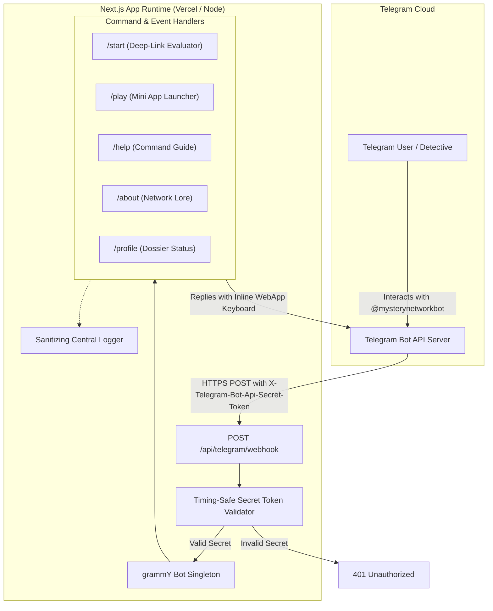

# MYSTERY NETWORK — Telegram Bot Integration

## 1. Overview & Identity

**MYSTERY NETWORK** integrates an official Telegram Bot acting as the primary onboarding conduit, case briefing dispatcher, and Mini App launcher.

- **Bot Username**: [@mysterynetworkbot](https://t.me/mysterynetworkbot)
- **Framework**: [grammY v1.46.0](https://grammy.dev/)
- **Integration Layer**: Next.js App Router route handler (`/api/telegram/webhook`)
- **Transport**: Webhook with cryptographic secret token verification

---

## 2. Telegram Architecture



---

## 3. Environment Variables

The following environment variables configure the Telegram integration. Placeholders are documented in [`.env.example`](../.env.example):

| Variable                            | Scope           | Description                                                                                                     |
| :---------------------------------- | :-------------- | :-------------------------------------------------------------------------------------------------------------- |
| `TELEGRAM_BOT_TOKEN`                | Server-Only     | Secret authentication token provided by [@BotFather](https://t.me/botfather). Never commit or expose to client. |
| `TELEGRAM_BOT_USERNAME`             | Server-Only     | Canonical username without `@` (Default: `mysterynetworkbot`).                                                  |
| `TELEGRAM_WEBHOOK_SECRET`           | Server-Only     | High-entropy random string (1-256 alphanumeric characters) used by Telegram to sign incoming webhook payloads.  |
| `TELEGRAM_WEBHOOK_URL`              | Server-Only     | Public HTTPS URL where Telegram sends updates (e.g. `https://your-domain.com/api/telegram/webhook`).            |
| `NEXT_PUBLIC_TELEGRAM_MINI_APP_URL` | Public / Client | Optional HTTPS URL of the deployed Mini App. When present, the bot provides interactive launch buttons.         |

> [!WARNING]
> **Token Security**: Never commit `.env` or `.env.local` to version control. Never log `TELEGRAM_BOT_TOKEN` or return it in API responses. If a bot token is ever exposed, revoke it immediately via [@BotFather](https://t.me/botfather) using `/revoke` and generate a fresh token.

---

## 4. Supported Bot Commands

Official commands are registered in Telegram's user menu via `setMyCommands`:

| Command    | Functionality                                                                                  | Deep-Link Support                                                 |
| :--------- | :--------------------------------------------------------------------------------------------- | :---------------------------------------------------------------- |
| `/start`   | Welcomes the operative, introduces the network motto, and presents the Mini App launch button. | Supports `/start invite_<TEAMCODE>` and `/start case_<CASECODE>`. |
| `/play`    | Provides an immediate inline launch button to open the Telegram Mini App.                      | Shows fallback status if the Mini App URL is not yet configured.  |
| `/profile` | Informs the operative that permanent investigator dossiers are accessed via the Mini App.      | N/A                                                               |
| `/about`   | Explains the asymmetric collaborative investigation premise of MYSTERY NETWORK.                | N/A                                                               |
| `/help`    | Lists all available commands and basic navigation instructions.                                | N/A                                                               |

### Deep-Link Parameters

The `/start` handler safely parses up to 64 alphanumeric characters following standard Telegram specifications:

- `/start invite_SQ7F2A`: Detects a squad invitation code for future automated team enrollment.
- `/start case_CASE-001`: Detects a specific case target for immediate briefing upon launching the Mini App.

---

## 5. Webhook Security & Implementation

### Endpoint: `POST /api/telegram/webhook`

1. **Header Verification**: Incoming requests must include the header `X-Telegram-Bot-Api-Secret-Token`.
2. **Constant-Time Comparison**: The header is compared against `TELEGRAM_WEBHOOK_SECRET` using `crypto.timingSafeEqual` to neutralize timing side-channel attacks.
3. **Payload Sanitization**: Webhook payloads are processed in-memory by grammY; confidential update internals are never printed raw to application logs.
4. **Immediate Acknowledgment**: The webhook returns HTTP `200 OK` promptly to prevent Telegram from repeatedly retrying unrecoverable client errors.
5. **Non-POST Rejection**: `GET` requests return HTTP `405 Method Not Allowed`.

---

## 6. CLI Management Commands

Administrative scripts are configured in `package.json` to manage the Telegram integration:

```bash
# 1. Inspect active webhook registration, pending update count, and error history
npm run telegram:info

# 2. Register the official Telegram bot command menu (start, play, help, etc.)
npm run telegram:set-commands

# 3. Register the public HTTPS webhook URL with Telegram Bot API
npm run telegram:set-webhook

# 4. Remove active webhook registration (e.g., to switch back to polling or change domains)
npm run telegram:delete-webhook
```

---

## 7. Local Development & Testing

During local development, your local Next.js server (`http://localhost:3000`) is not publicly reachable over the internet by Telegram's servers.

### Recommended Local Setup:

1. Start your local development server:
   ```bash
   npm run dev
   ```
2. In a separate terminal, expose port 3000 using Cloudflare Tunnels or ngrok:
   ```bash
   # Using Cloudflare Tunnel:
   cloudflared tunnel --url http://localhost:3000

   # Or using ngrok:
   ngrok http 3000
   ```
3. Copy the generated HTTPS forwarding URL (e.g., `https://abc-123.trycloudflare.com`) and configure your `.env.local`:
   ```env
   TELEGRAM_WEBHOOK_URL="https://abc-123.trycloudflare.com/api/telegram/webhook"
   TELEGRAM_WEBHOOK_SECRET="generate-a-secure-random-secret-string-here"
   ```
4. Register the webhook:
   ```bash
   npm run telegram:set-webhook
   ```
5. Send `/start` to `@mysterynetworkbot` in Telegram.

---

## 8. Troubleshooting

| Symptom                              | Probable Cause                                                 | Resolution                                                                                     |
| :----------------------------------- | :------------------------------------------------------------- | :--------------------------------------------------------------------------------------------- |
| `HTTP 401 Unauthorized`              | Missing or mismatched `X-Telegram-Bot-Api-Secret-Token`.       | Ensure `TELEGRAM_WEBHOOK_SECRET` matches the secret passed to `setWebhook`.                    |
| `HTTP 405 Method Not Allowed`        | Calling webhook with `GET` instead of `POST`.                  | Telegram webhooks only send `POST` requests.                                                   |
| `P1001: Can't reach database server` | Neon compute suspended from inactivity.                        | Ensure `&connect_timeout=30` is appended to `DATABASE_URL` and `DIRECT_URL`.                   |
| Bot does not respond                 | Webhook URL not set or points to localhost.                    | Telegram requires a valid, publicly resolvable HTTPS URL. Verify with `npm run telegram:info`. |
| Mini App button does not appear      | `NEXT_PUBLIC_TELEGRAM_MINI_APP_URL` is undefined or not HTTPS. | Set a valid HTTPS URL in `.env.local`.                                                         |
